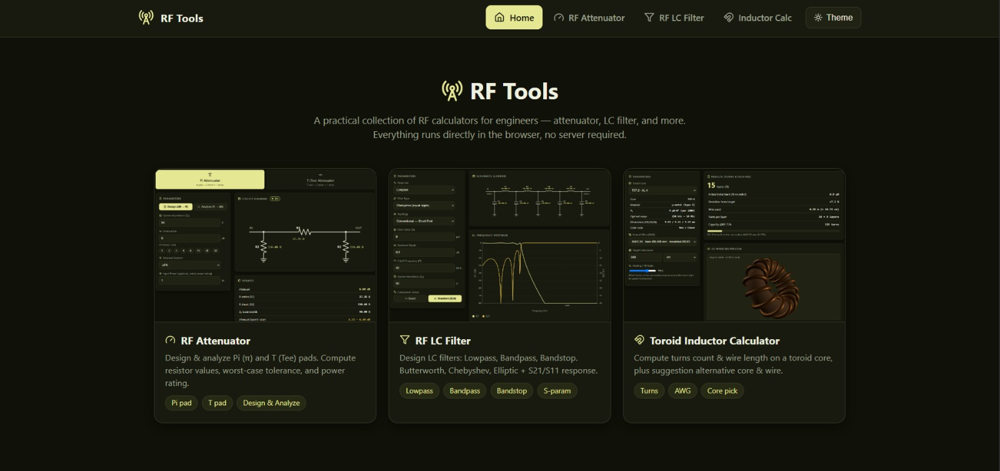

# RF Tools 📡

> Kumpulan kalkulator utilitas RF berbasis web — murni HTML/CSS/JS, berjalan sepenuhnya di browser tanpa server.

Saat ini tersedia:
- **RF Attenuator** — nilai resistor pad **Pi (π)** & **T (Tee)** lengkap dengan diagram, toleransi, dan power rating.
- **RF LC Filter Designer** — filter **Lowpass / Bandpass / Bandstop** (Butterworth & Chebyshev) dengan skema ladder, tabel komponen, dan grafik respons |S21|/|S11|.
- **Toroid Inductor Calculator** — computes turns count & wire length for a toroid core (A<sub>L</sub> data for 17 cores from [toroids.info](https://toroids.info/)), checks packing per layer, renders an interactive 3D winding preview (Three.js), and suggests alternative cores & wires.

## Badges


## Demo



[](https://muhammad-yunus.github.io/RF-Tools/)

## Fitur Utama

### RF Attenuator
- **Dua topologi** — **Pi (π)** dan **T (Tee)**, pilih lewat tab.
- **Mode Design (dB → R)** — masukkan impedansi sistem (Z₀, default 50 Ω) dan redaman target (dB), dapatkan nilai R series & R shunt.
- **Mode Analyze (R → dB)** — masukkan nilai resistor yang sudah ada, hitung redaman aktual dan impedansi karakteristiknya.
- **Toleransi resistor** — ±1 / ±2 / ±5 / ±10%, tampil rentang redaman *worst-case*.
- **Power rating** — disipasi per resistor dari input power, plus rekomendasi rating dan output power.

### RF LC Filter
- **Tiga respons** — **Lowpass**, **Bandpass**, **Bandstop**.
- **Dua tipe** — **Butterworth** (maximally flat) dan **Chebyshev** (equal ripple). *(Elliptic/Cauer menyusul.)*
- **Dua topologi** — Conventional **Series-First** dan **Shunt-First**.
- **Orde 1–10**, frekuensi cutoff (lowpass) atau band edges f₁–f₂ (bandpass/bandstop), satuan MHz.
- **Skema ladder SVG otomatis** — simbol L/C diskalakan, label dan nilai langsung tampil.
- **Tabel komponen** — nilai eksak atau dibulatkan ke deret **E24**.
- **Grafik respons** — kurva |S21| dan |S11| (dB) vs frekuensi (skala log), dihitung via matriks ABCD.

### Toroid Inductor
- **17 toroid cores** — µ-metal (T25–T200 type 2) & ferrite (T37-6, T50-6, T80-6, FT50/140/240-43/31), with A<sub>L</sub>, OD/ID/ht dimensions, and optimal frequency range.
- **Pick enamel wire (AWG 10–36)** + a *packing/fill* ratio to check whether the winding fits on the core surface.
- **Results**: turns count (N rounded up), actual inductance + deviation, wire length, and a packing indicator.
- **Automatic suggestions** — all cores ranked for the same target (best fit + smallest deviation + smallest core), plus an AWG recommendation if the current combination is tight.

### Umum
- **Tema gelap/terang** — flat & modern, palet primary `#E5E793` / secondary `#8B8D08`.
- **Ikon Lucide** pada menu, field, dan bagian penting.

---

### Mulai Cepat

Buka [RF Tools](https://muhammad-yunus.github.io/RF-Tools/) — tidak perlu instalasi apa pun.

Atau jalankan secara lokal:

```powershell
cd RF-Tools
python -m http.server 8000
# buka http://localhost:8000
```

## Struktur

```
index.html                  # landing page (daftar tool)
app/rf-attenuator.html      # halaman RF Attenuator
app/lc-filter.html          # halaman RF LC Filter
app/toroid-inductor.html    # halaman Toroid Inductor Calculator
assets/style.css            # tema + gaya bersama
assets/nav.js               # navbar + theme toggle (injected)
assets/rf-attenuator.js     # logika attenuator
assets/lc-filter.js         # logika filter LC (prototipe, transform, S-param, UI)
assets/data/toroids.js      # data A_L + tabel AWG untuk kalkulator induktor
assets/toroid-inductor.js   # logika kalkulator induktor toroid
.github/workflows/deploy.yml
```

## Rumus

### Attenuator

Dengan `K = 10^(dB/20)` dan impedansi sistem `Z₀`:

**Pi (π)**
```
R_series = Z₀ · (K² − 1) / (2K)
R_shunt  = Z₀ · (K + 1) / (K − 1)
```

**T (Tee)**
```
R_series = Z₀ · (K − 1) / (K + 1)
R_shunt  = Z₀ · 2K / (K² − 1)
```

Analisis balik (R → dB): `A = 1 + R_series/R_shunt`, lalu `K = A + √(A² − 1)`.

### Filter LC

Prototipe lowpass ternormalisasi (cutoff 1 rad/s, Z₀ = 1) memakai g-value klasik:

**Butterworth**
```
g_k = 2·sin((2k − 1)·π / (2N)),   k = 1..N
```

**Chebyshev** (ripple R dB)
```
β = ln(coth(R / 17.37))
γ = sinh(β / (2N))
a_k = sin((2k − 1)·π / (2N))
b_k = γ² + sin²(kπ / N)
g₁  = 2·a₁ / γ
g_k = 4·a_{k−1}·a_k / (b_{k−1}·g_{k−1})
```
`g_{N+1} = 1` untuk orde ganjil, `g_{N+1} = coth²(β/4)` untuk orde genap
(orde genap Chebyshev memiliki terminasi tak-sama secara klasik).

Transformasi LP → BP/BS: `ω₀ = √(ω₁·ω₂)`, `Δ = (ω₂ − ω₁)/ω₀`. Resonator disusun
sebagai LC seri (arm seri) atau LC paralel (arm shunt). Analisis respons memakai
matriks ABCD tiap cabang lalu dikonversi ke S-parameter.

### Toroid Inductor

Toroid core inductance: `L(uH) = A_L · N² / 1000`, so the minimum turns count is
`N = ceil( sqrt( L_target(uH) · 1000 / A_L ) )` (rounded up so that
inductance ≥ target). Packing estimate: turns per layer ≈
π·(OD+ID)/2 / Ø_insulated_wire, number of layers ≈ core height / Ø_wire;
usable turns = the product of the two multiplied by the fill ratio.

## Tech Stack

- **HTML/CSS/JavaScript** murni — tanpa framework, tanpa step build.
- **SVG** untuk skema rangkaian dan grafik (Canvas 2D untuk kurva respons).
- **Lucide** (`0.454.0`) untuk ikon.

## License

MIT
